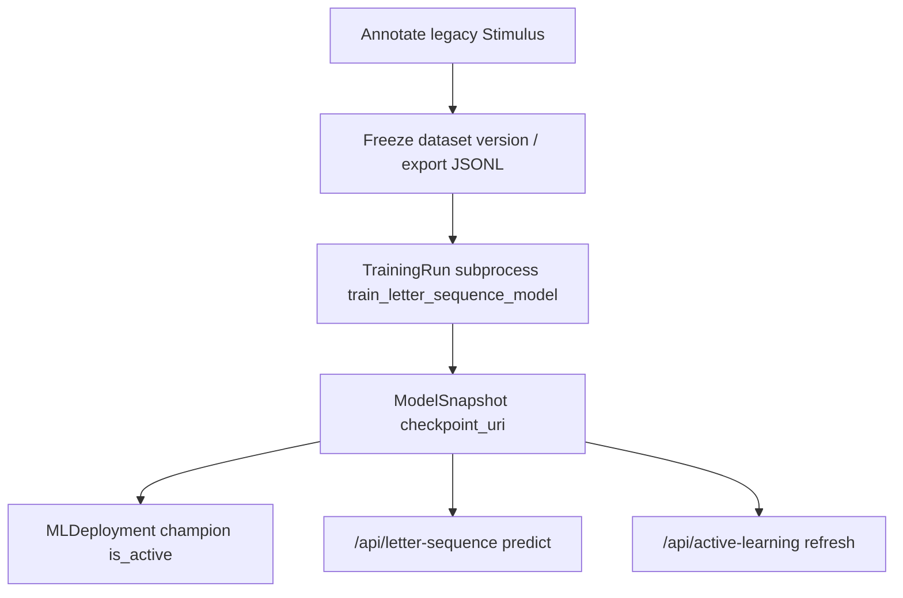

# English letter-sequence ML lifecycle

This document is the **authoritative map** for how English ML, active learning, and inference relate to database tables and API routes. For product split (English vs Chinese UI), see the root [README](../README.md).

## Which data model powers ML today?

| Role | Tables | Used by |
|------|--------|---------|
| **Legacy (ML / AL / training export)** | `dataset`, `stimulus`, `session`, `annotation`, `segmentation`, `span`, … | Workbench, `/api/datasets`, `/api/stimuli`, `/api/annotations`, `/api/active-learning`, `/api/training`, `/api/letter-sequence/*` |
| **`english_*` (product namespace)** | `english_annotation_sessions`, `english_word_instances`, … | `/api/english/*`, `apps/web-english/app/english/*` — **not** wired into letter-sequence training/export/AL today |

Training scripts and frozen datasets read **legacy** annotations. Do not assume `english_*` rows appear in `letter_sequence_samples.jsonl` unless you add an explicit bridge.

## End-to-end flow

1. **Annotate** — User saves annotations via `POST /api/annotations` or commit flows; segments must cover stimulus text exactly.
2. **Freeze / export** — Dataset version and `letter_sequence_samples.jsonl` under `artifacts/datasets/{id}/` (see [PHASE1_REPRODUCIBILITY.md](./PHASE1_REPRODUCIBILITY.md)).
3. **Train** — `POST /api/training/runs` spawns `scripts/train_letter_sequence_model.py`; checkpoints land under the run’s `out_dir` as `letter_sequence.pt`.
4. **Snapshot** — `ModelSnapshot` records `checkpoint_uri` and metadata.
5. **Promote champion** — `MLDeployment` row with `is_active=True` for `(environment, product_line=english, task_name=letter_sequence, alias=champion)` (see `scripts/promote_model_snapshot.py`).
6. **Predict / AL** — Checkpoint resolution order is implemented in `apps/api/app/services/letter_sequence_checkpoint_resolve.py`:
   - explicit `checkpoint_path_override` if file exists  
   - `snapshot_id` → `ModelSnapshot.checkpoint_uri`  
   - `LETTER_SEQUENCE_CHECKPOINT` env (see `Settings` in `app/db.py`)  
   - active champion `ml_deployment`  
   - latest `ModelSnapshot` by `created_at`

## Operational notes

- **`AmbiguousActiveDeploymentError`** — If more than one row is active for the same `(environment, product_line, task_name, alias)`, inference refuses to guess. Fix data or run dedupe (see migrations / startup checks).
- **SQLite dev** — `Base.metadata.create_all` on API startup plus `ensure_training_tables` / `sqlite_schema` patches; **production** should use Alembic.
- **Champion uniqueness** — A partial unique index enforces at most one `is_active=1` row per `(environment, product_line, task_name, alias)` (Alembic revision `u1v2w3x4y5z6`; SQLite dev applies the same via `sqlite_schema`).

## Syllable-aware letter-sequence (v3)

- **Preprocessing** — `letter_sequence.phonology.enrich_word` produces a fixed 16-dim per-letter `extra_features` (layout `phon_layout_v1`); **CMUdict** via `pronouncing`, with **orthography heuristic** for OOV. Graceful fallback leaves `phon_mask=0` on structured channels; legacy v2 JSONL only fills the first four channels (vowel, first, last, norm len).
- **Training JSONL** — `schema_version: 3` from `annotation_record_to_sample_v3` includes `extra_features`, `phon_mask`, and optional `target_dominant_letter_idx` / `target_word_lab` for auxiliary losses.
- **Model** — BiLSTM `extra_dim=16` (configurable); heads: per-letter Lab / P / S, pairwise boundary, optional **pred_spread_pair**, **pred_dominant_logits**, and **pred_word_lab** (prominence-weighted aggregate, not a detached word-only color head).
- **Ablation** — YAML `ablation` keys zero feature groups in **collate** (not the loss), for baseline vs stress-only experiments.
- **ONNX** — Export reports `onnx_out_version: 2` with seven outputs (core four + word_lab, dominant, spread_pair); older four-output graphs are still supported by the inference shim when the report does not list extras.
- **AL** — `compute_hybrid_al_scores` blends an optional **syllable/stress pattern rarity** term (`SYNGLYPH_AL_LAMBDA_SYLLABLE`) and a small **feedback-risk** down-weight from recent `model_review_feedback.lab_delta_mean` (`SYNGLYPH_AL_LAMBDA_FB_RISK`). `GET /api/active-learning/syllable-slice-report` returns a stub for future slice dashboards.
- **DB** (Alembic `f1g2h3i4j5k6`) — `word_pronunciation_cache`, optional `stimulus` pronunciation fields, HITL fields on `annotation`, syllable fields on `span`.

### Evaluation / ablation

- Use `packages/letter_sequence/configs/default.yaml` as the full-feature baseline; copy and set `ablation.use_syllable: false` (or stress/neighbors) for ablations. Compare `val_mae_*` and (when labels exist) `mae_word_lab` in `metrics.json`.
- Re-export ONNX after changing `extra_dim` or output heads; run `scripts/parity_test_bilstm_onnx.py` against the new graph.
